# FYP deployment

Terraform deploys the quiz application — frontend, backend, PostgreSQL,
SeaweedFS and vLLM on one GPU serving instance — plus a nightly
Qwen3.5-9B retraining workflow that turns the latest published training
dataset into new grading and feedback model candidates on Hugging Face.

| Component | Role |
| --- | --- |
| Serving EC2 (`g5.xlarge`, static EIP) | Frontend, backend, PostgreSQL, SeaweedFS and vLLM; also the "backend host" for dataset export and candidate publication |
| Training EC2 (same instance type by default) | Dedicated GPU for retraining; kept stopped while idle, persistent 200 GiB encrypted root volume |
| EventBridge Scheduler | Starts retraining daily at **00:10 SGT** when enabled (disabled by default) |
| Step Functions + Lambda + SSM | Coordinates export, GPU start/train/stop, publication and the backend callback |
| Private versioned S3 bucket | Dataset snapshots, candidate artifacts, publication receipts and lock/run state |
| Hugging Face | Public candidate branches: `SmuFypTeam5/GradingQlora` and `SmuFypTeam5/feedback` (`candidate-<run_id>`; main branches are never updated) |

See the [retraining workflow diagram, setup and recovery details](autotraining/README.md).

## Topology

```mermaid
flowchart TD
    subgraph AWS["AWS (us-east-1 by default)"]
        subgraph VPC["VPC 10.42.0.0/16 — single AZ chosen to fit both instance types"]
            S["Serving EC2<br/>frontend :3000 · backend :8002 · Postgres :5433 (local) · vLLM :8000 (private)"]
            T["Training EC2<br/>stopped while idle<br/>public IP for Instance Connect only"]
        end
        SCH["EventBridge Scheduler<br/>00:10 SGT (opt-in)"] --> SM["Step Functions<br/>&#60;name&#62;-nightly-training"]
        SM --> L["Lambda coordinator<br/>(short SSM/EC2/StepFunctions calls)"]
        L -->|SSM RunCommand| S
        L -->|SSM RunCommand| T
        S3[("S3 (private, versioned)<br/>datasets/ candidates/ control/ publications/ scripts/")]
        L <--> S3
        S <-->|S3, export and publish| S3
        T <-->|S3, download and upload| S3
        TERM["CloudWatch events: terminal execution + 15-min watchdog"] --> L
    end
    S -->|HTTP :8002 private| CB["Callback POST /api/v1/training-runs<br/>(X-Training-Token from SSM)"]
    S -->|HF API, token from SSM| HF[("Hugging Face<br/>candidate branches")]
    S -->|states:StartExecution| SM
    FE["Browser"] -->|:3000| S
    IN["Instructor UI → Train now"] --> FE
```



## Run Terraform

Requirements: Terraform 1.5+, authenticated AWS CLI, and GPU quota in the
selected region (`us-east-1` by default).

Terraform selects the first available Availability Zone that supports both
serving and training instance types; pin another with `availability_zone`
in local tfvars (e.g. `us-east-1a`). An unsupported override or no shared
zone fails during planning.

Before applying, create these **SSM SecureString** parameters in the
deployment region:

| Parameter | Value |
| --- | --- |
| `/fyp/training/hf-token` | Hugging Face token with write access to both candidate repos |
| `/fyp/training/callback-token` | Random, nonempty single-line machine credential |

Terraform stores only their names, never their values. Bootstrap reads the
callback credential on the serving host and writes it to the backend's
private Compose `.env`; a missing or invalid credential fails bootstrap.

From this directory:

```bash
terraform init
terraform fmt
terraform validate
terraform plan -out=deployment.tfplan
terraform apply deployment.tfplan
terraform output
```

Review the plan before applying. Replacing `aws_instance.llm` deletes its
instance-local application data; do not apply while training is running.
Fresh stacks wait 15 minutes after enabling S3 versioning before uploading
training scripts (AWS propagation guidance); the wait repeats only if the
versioning resource is replaced or reconfigured.

After startup (confirm with `sudo cloud-init status --wait`):

- Frontend: `http://<public_ip>:3000`
- Backend: `http://<public_ip>:8002/health`
- vLLM: private port 8000; use `./connect-vllm.sh` (SSM port forwarding)

Bootstrap creates the application `.env` files (random `JWT_SECRET`,
`API_KEY`, `POSTGRES_PASSWORD`, the callback credential, the workflow ARN,
and the LLM model aliases) and starts both Compose stacks. Nightly
scheduling stays **disabled by default**; enable it with
`autotraining_schedule_enabled = true` in `nightly.auto.tfvars` after a
verified end-to-end run (see [autotraining/README.md](autotraining/README.md#run-terraform-and-test)).

## Grading and feedback on one vLLM instance

The serving wrapper loads `Qwen/Qwen3.5-9B` once (4-bit bitsandbytes,
eager mode) and registers two LoRA adapters plus the bare base model:

| HF adapter | vLLM model alias | Backend setting |
| --- | --- | --- |
| `SmuFypTeam5/GradingQlora` | `qwen35-9b-grading-qlora` | `LLM_MODEL` |
| `SmuFypTeam5/feedback` | `qwen35-9b-feedback-qlora` | `LLM_FEEDBACK_MODEL` |
| — (adapter disabled) | `qwen35-9b-base` | few-shot grading / debugging |

All three aliases share port 8000 and `/v1/chat/completions`. The backend
selects the grading adapter for binary criterion labels, then the feedback
adapter for plain-text feedback. The wrapper uses
`--enable-lora --lora-modules name=path name=path`
([vLLM 0.29 LoRA serving](https://docs.vllm.ai/en/v0.29.0/features/lora/))
with `--max-lora-rank 64`; `FYP_VLLM_MAX_LORAS=1` limits adapters per GPU
batch and `FYP_VLLM_MAX_CPU_LORAS=4` caches adapters in CPU memory, so
runtime adapter swaps (model deployment) work without exceeding GPU memory.
It loads the `bitsandbytes,lora_filesystem_resolver` vLLM plugins; the
bitsandbytes plugin registers the 4-bit quantization used at startup.

New hosts enable runtime adapter loading automatically. The vLLM systemd
unit runs a readiness check as `ExecStartPost` that polls up to 40 minutes
for `/health`, all three model aliases, and the runtime adapter-loading
endpoint before the service is considered active; the unit itself has a
45-minute start timeout and retries on failure. The same check runs on
restarts, and bootstrap blocks until it passes before starting the apps.
The CloudWatch agent reattaches afterwards so the vLLM journal keeps
flowing to `/fyp/<name>/vllm`.

### Serving HF token from SSM

By default, serving reuses the existing `/fyp/training/hf-token`
SecureString. Terraform passes the parameter name and region to systemd and
grants the serving role `ssm:GetParameter`; the wrapper fetches it with
`--with-decryption` at each start and exports `HF_TOKEN` only to the running
process (never to a file or Terraform state). A lookup failure stops
startup instead of falling back to a stale token. Select another parameter
with `vllm_hf_token_parameter` (and an optional customer-managed
`vllm_hf_token_kms_key_arn`; the key policy must allow the serving role);
set the variable to `""` to disable lookup, or leave
`HF_TOKEN_SSM_PARAMETER` unset and export `HF_TOKEN` directly for local
serving.

To update an **existing** serving host without replacing the instance,
install the current deployment checkout on that host and apply:

```bash
sudo install -o ubuntu -g ubuntu -m 0755 Script/serve_qwen35_vllm.sh /opt/qwen-vllm/Script/serve_qwen35_vllm.sh
sudo install -o ubuntu -g ubuntu -m 0644 Script/requirements-vllm.txt /opt/qwen-vllm/Script/requirements-vllm.txt
sudo install -o ubuntu -g ubuntu -m 0644 Script/check_vllm_ready.py /opt/qwen-vllm/Script/check_vllm_ready.py
sudo apt-get update
sudo apt-get install -y awscli
sudo mkdir -p /etc/systemd/system/qwen-vllm.service.d
sudo tee /etc/systemd/system/qwen-vllm.service.d/20-adapters.conf >/dev/null <<'UNIT'
[Service]
Environment=HF_TOKEN_SSM_PARAMETER=/fyp/training/hf-token
Environment=HF_TOKEN_SSM_REGION=us-east-1
Environment=FYP_LORA_RUNTIME_ENABLED=true
Environment=FYP_LORA_ADAPTER_DIRECTORY=/mnt/llm-data/adapters
Environment=FYP_VLLM_MAX_CPU_LORAS=4
EnvironmentFile=-/etc/qwen-vllm.env
ExecStartPost=/usr/bin/python3 /opt/qwen-vllm/Script/check_vllm_ready.py
TimeoutStartSec=45min
UNIT
sudo install -d -o ubuntu -g ubuntu /mnt/llm-data/adapters
sudo systemctl daemon-reload
sudo systemctl restart qwen-vllm.service
sudo journalctl -u qwen-vllm.service -f
```

`/etc/qwen-vllm.env` remains optional for model/path overrides. Verify both
adapter aliases with `curl --fail --silent --show-error http://127.0.0.1:8000/v1/models`.

### Backend environment

The bootstrap writes backend settings that match the served aliases:

```dotenv
LLM_URL=http://host.docker.internal:8000/v1/chat/completions
LLM_MODEL=qwen35-9b-grading-qlora
LLM_GRADING_CONTRACT=criteria_array_v1
LLM_FEEDBACK_MODEL=qwen35-9b-feedback-qlora
```

After updating an existing backend checkout, rebuild it with
`sudo docker compose --project-directory /opt/fyp/backend up --build -d api`.
The shared adapter directory uses mode `2775` with the host user's group as
`MODEL_ADAPTER_GID` (passed to the API container), so the backend can
download candidate adapters and vLLM can read them; keep the path identical
in both places.

## Bootstrap

`Script/bootstrap_apps.sh` is the shared application bootstrap for Terraform
and standalone setup. Terraform installs it as
`/usr/local/sbin/bootstrap-fyp-apps`, which supplies the workflow ARN,
callback parameter and AWS region. Standalone use requires the ARN before it
touches application files:

```bash
sudo env TRAINING_STATE_MACHINE_ARN='<autotraining_state_machine_arn output>' \
  AWS_REGION=us-east-1 \
  TRAINING_CALLBACK_TOKEN_PARAMETER=/fyp/training/callback-token \
  bash Script/bootstrap_apps.sh
```

Steps: clone `backend` and `frontend` to `/opt/fyp/`, write both `.env`
files, validate and install the callback token from SSM
(`configure_training_callback.py`, atomic write, fails bootstrap on error),
create the shared adapter directory, then `docker compose up --build -d`
for the backend and frontend.

## CI

`.github/workflows/autotraining.yml` runs static checks on pull requests and
pushes to `main` (path-filtered): Python syntax compile, `bash -n` on all
shell scripts, `ruff`, the `autotraining/tests` and `Script/tests` unit
suites, and `terraform fmt -check` + `terraform init -backend=false &&
terraform validate`. No AWS credentials or GPU are used.

## Operate

```bash
aws ssm start-session \
  --region "$(terraform output -raw region)" \
  --target "$(terraform output -raw instance_id)"
```

On the serving host:

```bash
sudo docker compose --project-directory /opt/fyp/backend logs -f
sudo journalctl -u qwen-vllm -f
```

Training execution status is in Step Functions; training and coordinator
logs are in CloudWatch (`/fyp/<name>/training`, the Lambda log group).
Teardown, recovery and the full retraining runbook are documented in
[autotraining/README.md](autotraining/README.md).
