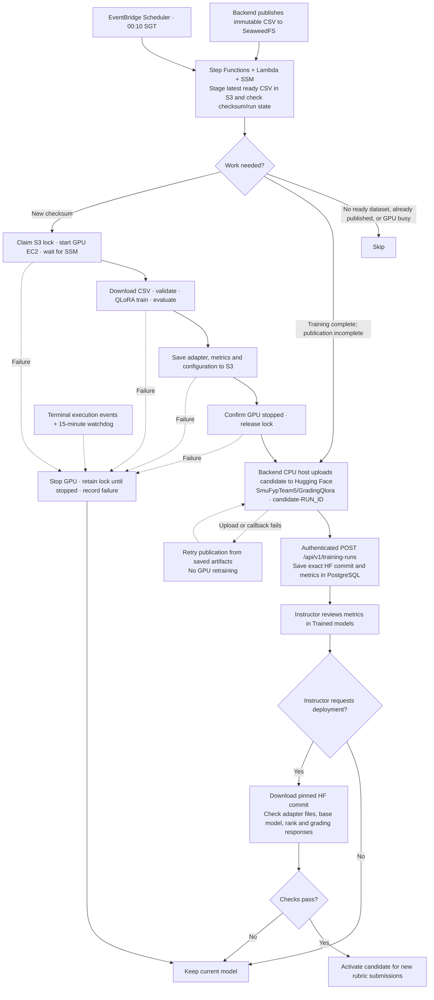

# Nightly retraining

Retrain **Qwen3.5-9B** at **00:10 SGT** when a new ready dataset is available. Publish the evaluated adapter to Hugging Face, report its metrics to the backend, and let an instructor explicitly deploy it.

## Workflow



Step Functions handles waits; Lambda performs short coordination calls. S3 conditional writes prevent overlapping GPU runs. HF upload starts after GPU shutdown. Only an acknowledged backend callback marks the checksum published.

Candidates include dataset identity, configuration, baseline/candidate metrics and an exact HF commit. Publishing never changes the active model. Accepted grading jobs keep their saved model; few-shot grading uses the original configured model.

## Setup

`SmuFypTeam5/GradingQlora` is public. Reads and downloads are anonymous; only branch creation and uploads use the HF token stored in SSM.

1. Deploy the updated backend/frontend and ensure the backend and SeaweedFS are running and the serving host is SSM-ready.
2. Create these **SSM SecureString** parameters in the deployment region:

   | Parameter | Value |
   | --- | --- |
   | `/fyp/training/hf-token` | Token with write access to `SmuFypTeam5/GradingQlora` |
   | `/fyp/training/callback-token` | Random machine credential matching backend `TRAINING_CALLBACK_TOKEN` |

3. Set the backend `.env` values below, then rebuild/restart its Compose service:

   ```dotenv
   TRAINING_CALLBACK_TOKEN=<same callback credential>
   TRAINING_HF_REPO=SmuFypTeam5/GradingQlora
   MODEL_ADAPTER_DIRECTORY=/mnt/llm-data/adapters
   ```

4. Install the updated [serving wrapper](../Script/serve_qwen35_vllm.sh) on the serving host. Add this override with `sudo systemctl edit qwen-vllm.service`, then reload systemd and restart the service:

   ```ini
   [Service]
   Environment=FYP_LORA_RUNTIME_ENABLED=true
   Environment=FYP_LORA_ADAPTER_DIRECTORY=/mnt/llm-data/adapters
   Environment=FYP_VLLM_MAX_CPU_LORAS=4
   ```

Keep vLLM port 8000 private. The adapter directory must use the same path in the backend container and serving host.

## Run Terraform and test

From the deployment directory, with AWS credentials and GPU quota configured:

```bash
terraform init
terraform fmt
terraform validate
terraform plan -out=autotraining.tfplan
terraform apply autotraining.tfplan
```

Review the plan before applying; avoid replacing the serving instance or applying during training. The schedule remains disabled.

Start one manual run:

```bash
aws stepfunctions start-execution \
  --region "$(terraform output -raw region)" \
  --state-machine-arn "$(terraform output -raw autotraining_state_machine_arn)" \
  --input '{}'
```

Confirm GPU shutdown, the HF candidate branch, backend metrics and instructor deployment checks. Then save this in a local `nightly.auto.tfvars` file:

```hcl
autotraining_schedule_enabled = true
```

Run `terraform plan -out=enable.tfplan`, review it, then `terraform apply enable.tfplan`. Set the variable to `false` and repeat plan/apply to disable nightly starts.

## Training and recovery

- **QLoRA:** rank 48 / alpha 96, NF4 4-bit with double quantization, learning rate 5e-5, up to three epochs, batch 1 × accumulation 8, 4,096-token limit and an 80/10/10 question-group split. See [train.py](train.py) and [requirements.txt](requirements.txt).
- **CSV:** uses the backend rubric schema. Partial-credit rows and missing desired answers are excluded and counted; at least ten compatible unique questions are required.
- **Recovery:** training has a 12-hour SSM timeout. Terminal events and a 15-minute watchdog clean up failed/abandoned executions; the watchdog stops GPU runs older than 14 hours.
- **Storage:** S3 retains unpublished artifacts and current run records. Published staging copies become eligible for expiry once older than 30 days; HF retains the published commit.
- **Status:** inspect Step Functions executions, CloudWatch training/coordinator logs, and **Instructor → Trained models**. Verify a live AWS/GPU/HF/vLLM run before enabling the schedule.
