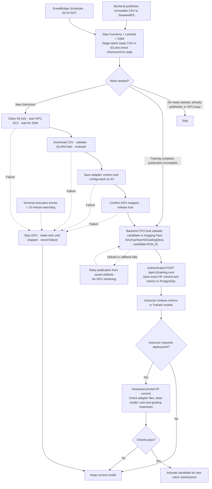

# Nightly retraining

Retrain **Qwen3.5-9B** at **00:10 SGT** when a new ready dataset is available. Publish the evaluated adapter to Hugging Face, report its metrics to the backend, and let an instructor explicitly deploy it.

## Workflow



Step Functions handles waits; Lambda performs short coordination calls. S3 conditional writes prevent overlapping GPU runs. HF upload starts after GPU shutdown. Only an acknowledged backend callback marks the checksum published.

Candidates include dataset identity, configuration, baseline/candidate metrics and an exact HF commit. Publishing never changes the active model. Accepted grading jobs keep their saved model; few-shot grading uses the original configured model.

## Setup

`SmuFypTeam5/GradingQlora` is public. Reads and downloads are anonymous; only branch creation and uploads use the HF token stored in SSM.

1. Deploy the updated backend/frontend and ensure the backend and SeaweedFS are running and the serving host is SSM-ready.
2. Create these **SSM SecureString** parameters in the deployment region:

   | Parameter | Value |
   | --- | --- |
   | `/fyp/training/hf-token` | Token with write access to `SmuFypTeam5/GradingQlora` |
   | `/fyp/training/callback-token` | Random machine credential matching backend `TRAINING_CALLBACK_TOKEN` |

3. Set the backend `.env` values below, then rebuild/restart its Compose service:

   ```dotenv
   TRAINING_CALLBACK_TOKEN=<same callback credential>
   TRAINING_STATE_MACHINE_ARN=<autotraining_state_machine_arn Terraform output>
   TRAINING_HF_REPO=SmuFypTeam5/GradingQlora
   MODEL_ADAPTER_DIRECTORY=/mnt/llm-data/adapters
   ```

4. Install the updated [serving wrapper](../Script/serve_qwen35_vllm.sh) on the serving host. Add this override with `sudo systemctl edit qwen-vllm.service`, then reload systemd and restart the service:

   ```ini
   [Service]
   Environment=FYP_LORA_RUNTIME_ENABLED=true
   Environment=FYP_LORA_ADAPTER_DIRECTORY=/mnt/llm-data/adapters
   Environment=FYP_VLLM_MAX_CPU_LORAS=4
   ```

Keep vLLM port 8000 private. The adapter directory must use the same path in the backend container and serving host.

The serving wrapper also loads `SmuFypTeam5/feedback` as
`qwen35-9b-feedback-qlora`. Backend `LLM_FEEDBACK_MODEL` must match this alias;
`LLM_GRADING_CONTRACT=criteria_array_v1` selects the grading adapter's binary
output format. Feedback uses the reference training prompt with both `[MET]`
and `[NOT MET]` points, and returns plain text. If the feedback repository is
private, provide Hugging Face read access to the vLLM service or set
`FEEDBACK_LORA_PATH` to an already downloaded adapter directory. Never commit
the access token. The grading candidate registry continues downloading its
public adapters anonymously and does not deploy feedback adapters.

Serving reads its HF token from the existing SSM SecureString named by
`vllm_hf_token_parameter` (default `/fyp/serving/hf-token`). Terraform grants the
serving role access and passes the parameter identity to systemd; the wrapper
fetches the value at startup. No serving `.env` file is required. This is separate
from the publisher's write token at `/fyp/training/hf-token`; the serving token
only needs read access to both adapters. See the [serving setup](../README.md#grading-and-feedback-on-one-vllm-instance).

## Run Terraform and test

From the deployment directory, with AWS credentials and GPU quota configured:

```bash
terraform init
terraform fmt
terraform validate
terraform plan -out=autotraining.tfplan
terraform apply autotraining.tfplan
```

Review the plan before applying; avoid replacing the serving instance or applying during training. The schedule remains disabled.

After applying, set backend `TRAINING_STATE_MACHINE_ARN` to `terraform output -raw autotraining_state_machine_arn`, then rebuild/restart the backend and updated frontend. The backend uses the serving EC2 instance role; Terraform grants `states:StartExecution` only for this workflow and sets the IMDSv2 response hop limit to 2 so the Docker container can obtain role credentials. No AWS access keys belong in the frontend or backend `.env`.

Sign in as an instructor, open **Trained models**, and select **Start training** to request one run on the latest ready dataset. The page shows acceptance or an error and refreshes candidates automatically. A request can be skipped by the workflow if no new ready dataset is available or the GPU is busy. Training does not activate the resulting model; review and deploy the candidate separately. Failed browser requests retain their request ID so retries cannot start the same request twice.

Alternatively, start one manual run from the CLI:

```bash
aws stepfunctions start-execution \
  --region "$(terraform output -raw region)" \
  --state-machine-arn "$(terraform output -raw autotraining_state_machine_arn)" \
  --input '{}'
```

Confirm GPU shutdown, the HF candidate branch, backend metrics and instructor deployment checks. Then save this in a local `nightly.auto.tfvars` file:

```hcl
autotraining_schedule_enabled = true
```

Run `terraform plan -out=enable.tfplan`, review it, then `terraform apply enable.tfplan`. Set the variable to `false` and repeat plan/apply to disable nightly starts.

## Training and recovery

- **Instance:** a dedicated training EC2 instance inherits the serving instance type (`g5.xlarge` currently). Leave `autotraining_instance_type` unset or `null` to keep them matched; an explicit value overrides this default. Training remains isolated from the serving instance.
- **QLoRA:** rank 48 / alpha 96, NF4 4-bit with double quantization, learning rate 5e-5, up to three epochs, batch 1 × accumulation 8, 4,096-token limit and an 80/10/10 question-group split. See [train.py](train.py) and [requirements.txt](requirements.txt).
- **CSV:** uses the backend rubric schema. Partial-credit rows and missing desired answers are excluded and counted; at least ten compatible unique questions are required.
- **Recovery:** training has a 12-hour SSM timeout. Terminal events and a 15-minute watchdog clean up failed/abandoned executions; the watchdog stops GPU runs older than 14 hours.
- **Local storage:** the trainer retains its encrypted 200 GiB gp3 EBS root volume when using `g5.xlarge`. `/opt/fyp-autotraining` contains the dataset, model checkout, virtual environment, managed Python, HF/package caches and checkpoints. The run script checks for at least 60 GiB free before downloads (`FYP_TRAINING_MIN_FREE_GIB` can override this budget), prints the actual workspace filesystem, and cleans each run's temporary files and output directory on exit. Completed-run markers and caches remain on EBS across nightly stops. It does not depend on or format the DLAMI NVMe instance store. `FYP_TRAINING_WORK_DIRECTORY` can override the workspace path; use persistent storage if overriding it.
- **Artifact storage:** S3 retains unpublished artifacts and current run records. Published staging copies become eligible for expiry once older than 30 days; HF retains the published commit.
- **Status:** inspect Step Functions executions, CloudWatch training/coordinator logs, and **Instructor → Trained models**. Verify a live AWS/GPU/HF/vLLM run before enabling the schedule.
