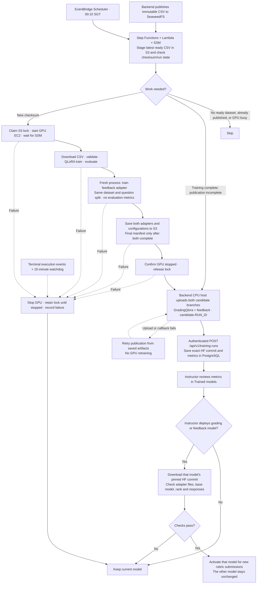

# Nightly retraining

Retrain **Qwen3.5-9B** at **00:10 SGT** when a new ready dataset is available. Train the grading adapter first, then the feedback adapter; publish both to Hugging Face as one run. Only grading has evaluation metrics. An instructor deploys the grading and feedback models separately.

## Workflow



Step Functions handles waits; Lambda performs short coordination calls. S3 conditional writes prevent overlapping GPU runs. HF upload starts after GPU shutdown. Only an acknowledged backend callback marks the checksum published.

Candidates include dataset identity, grading metrics, both configurations and exact HF commits for both adapters. They appear together in one Trained Models card, where each model has its own deploy button and status. Feedback has no generated evaluation metrics; validation loss is used internally to select its checkpoint. Publishing never changes the active models. Accepted grading jobs keep both pinned models; few-shot grading uses the original configured model.

`run_training.sh` validates feedback targets before GPU training, runs `train.py`
with `--grading-only`, then runs `train_feedback.py` in a separate process. The
grading manifest stays at `grading/result.json` until feedback finishes. A failed
feedback stage cannot register a partial pair. Publication retries reconcile each
HF branch independently; a grading upload need not repeat if the feedback upload
failed. Both uploads must finish before the single backend callback is sent.

Feedback follows `feedback/qlora_feedback_qwen3.5-9B.ipynb`: NF4 QLoRA rank 16 /
alpha 32, learning rate 1e-4, up to three epochs, assistant-completion loss, and
the same MET/NOT MET prompt. For the 24-GiB training GPU, batch 1 with accumulation
16 preserves the notebook's effective batch size 16. Both adapters use the exact
same base-model revision and seed-42 question split. Empty feedback targets are
excluded after splitting; training and validation must each retain a target.
Test questions remain held out and are not evaluated for feedback.

## Setup

The candidate repositories default to `SmuFypTeam5/GradingQlora` and
`SmuFypTeam5/feedback`. Each receives a separate `candidate-RUN_ID` branch; neither
repository's main branch is updated. Candidate reads and downloads are anonymous,
so both repositories need public read access. Only branch creation and uploads
use the HF token stored in SSM.

1. Before applying Terraform, create these **SSM SecureString** parameters in the deployment region:

   | Parameter | Value |
   | --- | --- |
   | `/fyp/training/hf-token` | Token with write access to both `SmuFypTeam5/GradingQlora` and `SmuFypTeam5/feedback` |
   | `/fyp/training/callback-token` | Random, nonempty single-line machine credential |

2. Apply the updated Terraform deployment. Bootstrap retrieves the existing
   callback SecureString with the serving instance role and configures backend
   `TRAINING_CALLBACK_TOKEN` before starting Compose. The publisher reads the
   same parameter. Terraform stores only its name, never its value; changing
   `autotraining_callback_token_parameter` changes both lookups. Bootstrap fails
   if lookup or validation fails, instead of starting an unconfigured backend.

3. New hosts also receive `TRAINING_STATE_MACHINE_ARN` automatically. For an
   existing host, install the current deployment checkout and run this helper
   to configure the callback from SSM, using your parameter name and region:

   ```bash
   sudo python3 Script/configure_training_callback.py \
     --env-file /opt/fyp/backend/.env \
     --parameter /fyp/training/callback-token --region us-east-1
   sudo docker compose --project-directory /opt/fyp/backend up -d api
   ```

   Configure the workflow ARN and any optional repository settings in the
   backend `.env` as needed, then rebuild/restart its Compose service:

   ```dotenv
   TRAINING_STATE_MACHINE_ARN=<autotraining_state_machine_arn Terraform output>
   TRAINING_HF_REPO=SmuFypTeam5/GradingQlora
   TRAINING_FEEDBACK_HF_REPO=SmuFypTeam5/feedback
   MODEL_ADAPTER_DIRECTORY=/mnt/llm-data/adapters
   # Optional hands-off promotion: nightly runs that beat the base model's
   # held-out MAE and QWK deploy automatically, still behind smoke tests.
   TRAINING_AUTO_DEPLOY_ENABLED=false
   ```

4. New Terraform hosts enable runtime adapter loading and check vLLM readiness
   automatically. For existing hosts, follow the
   [serving update procedure](../README.md#grading-and-feedback-on-one-vllm-instance)
   to install the updated wrapper and readiness script, configure systemd, and
   restart vLLM. The service uses these settings:

   ```ini
   [Service]
   Environment=FYP_LORA_RUNTIME_ENABLED=true
   Environment=FYP_LORA_ADAPTER_DIRECTORY=/mnt/llm-data/adapters
   Environment=FYP_VLLM_MAX_CPU_LORAS=4
   ```

Keep vLLM port 8000 private. The adapter directory must use the same path in the backend container and serving host.

The API downloads candidate adapters as an unprivileged container user. Bootstrap
sets the shared directory to mode `2775` and passes the host user's group as
`MODEL_ADAPTER_GID`; Compose adds this supplementary group to the API. This lets
the API write adapters and vLLM read them. For an existing host, set the directory's
group to the vLLM user's group, apply mode `2775`, set `MODEL_ADAPTER_GID` in the
backend `.env` to that group's numeric id, and recreate the API container with
the updated Compose file.

The serving wrapper also loads `SmuFypTeam5/feedback` as
`qwen35-9b-feedback-qlora`. Backend `LLM_FEEDBACK_MODEL` must match this alias;
`LLM_GRADING_CONTRACT=criteria_array_v1` selects the grading adapter's binary
output format. Feedback uses the reference training prompt with both `[MET]`
and `[NOT MET]` points, and returns plain text. If the feedback repository is
private, provide Hugging Face read access to the vLLM service or set
`FEEDBACK_LORA_PATH` to an already downloaded adapter directory. Never commit
the access token. The candidate registry downloads the requested candidate
adapter anonymously, checks its responses, and switches only that model after
its checks pass. The active grading and feedback adapters may come from
different runs. Deploying an older grading-only run leaves the active feedback
model unchanged.

Serving reads its HF token from the existing SSM SecureString named by
`vllm_hf_token_parameter` (default `/fyp/training/hf-token`). Terraform grants the
serving role access and passes the parameter identity to systemd; the wrapper
fetches the value at startup. No serving `.env` file is required. By default it
reuses the publisher's existing token; that token must also read the feedback
adapter. A dedicated read-only serving token can be selected with a different
parameter path. See the [serving setup](../README.md#grading-and-feedback-on-one-vllm-instance).

## Run Terraform and test

From the deployment directory, with AWS credentials and GPU quota configured:

```bash
terraform init
terraform fmt
terraform validate
terraform plan -out=autotraining.tfplan
terraform apply autotraining.tfplan
```

Review the plan before applying; avoid replacing the serving instance or applying during training. The schedule remains disabled.

New deployments set backend `TRAINING_STATE_MACHINE_ARN` automatically. For existing hosts, set it to `terraform output -raw autotraining_state_machine_arn`, then rebuild/restart the backend and updated frontend. The backend uses the serving EC2 instance role; Terraform grants `states:StartExecution` and `states:ListExecutions` only for this workflow and sets the IMDSv2 response hop limit to 2 so the Docker container can obtain role credentials. `ListExecutions` backs the read-only `GET /api/v1/training-runs/in-progress` view, which shows a running or recently failed training run on **Trained models** before any candidate is registered and fails open to an empty list when AWS is unreachable. No AWS access keys belong in the frontend or backend `.env`.

Sign in as an instructor, open **Trained models**, and select **Train now** to request one run on the latest ready dataset at any time. Manual requests retrain an unchanged dataset; the GPU lock still skips overlapping runs. The page shows acceptance or an error and refreshes candidates automatically. Training publishes only a candidate branch and does not activate the resulting model; review and deploy it separately. Failed browser requests retain their request ID so retries cannot start the same request twice.

Alternatively, start one manual run from the CLI:

```bash
aws stepfunctions start-execution \
  --region "$(terraform output -raw region)" \
  --state-machine-arn "$(terraform output -raw autotraining_state_machine_arn)" \
  --input '{}'
```

The empty input keeps scheduled-run behaviour, including checksum deduplication.
Use `--input '{"force_retrain":true}'` to request fresh training of the latest
ready CSV even if its checksum was published previously. Neither input bypasses
the GPU lock. The backend's `app/demo/dataset/mock_training_data.csv` exercises
this same workflow with ten unique questions and an 8/1/1 split. With demo seeding
enabled, backend startup uploads it once as a new version, including over the
previous bundled demo dataset. Wait for it
to be active and ready with ten rows before clicking **Train now**. Later
instructor uploads are preserved across restarts. See the dataset folder's README.

Confirm GPU shutdown, the HF candidate branch, backend metrics and instructor deployment checks. Then save this in a local `nightly.auto.tfvars` file:

```hcl
autotraining_schedule_enabled = true
```

Run `terraform plan -out=enable.tfplan`, review it, then `terraform apply enable.tfplan`. Set the variable to `false` and repeat plan/apply to disable nightly starts.

## Training and recovery

- **Instance:** a dedicated training EC2 instance inherits the serving instance type (`g5.xlarge` currently). Leave `autotraining_instance_type` unset or `null` to keep them matched; an explicit value overrides this default. Training remains isolated from the serving instance.
- **SSH:** while the trainer is running, select it in the EC2 console, choose **Connect → EC2 Instance Connect**, use its public IPv4 address, and sign in as `ubuntu`. Port 22 accepts the region's AWS-managed EC2 Instance Connect prefix list. The console identity needs permission to use Instance Connect. SSM remains available for training commands and diagnostics.
- **QLoRA:** rank 48 / alpha 96, NF4 4-bit with double quantization, learning rate 5e-5, up to three epochs, batch 1 × accumulation 8, 4,096-token limit and an 80/10/10 question-group split. See [train.py](train.py) and [requirements.txt](requirements.txt).
- **CSV:** accepts the backend's nine-column rubric schema with trailing `feedback`, plus legacy eight-column datasets. The grading stage ignores feedback text; the feedback stage uses nonempty saved explanations as completion targets. Paired training requires feedback targets in both its training and validation question groups. Partial-credit rows and missing desired answers are excluded and counted; at least one compatible row is required. Fewer than ten unique questions reuse training data for validation and evaluation, recorded as `held_out_evaluation=false` and `split_strategy=reuse_training_data` in the grading configuration. Larger datasets retain the grouped 80/10/10 split.
- **Recovery:** training has a 12-hour SSM timeout. Terminal events and a 15-minute watchdog clean up failed/abandoned executions; the watchdog stops GPU runs older than 14 hours.
- **Publication failure:** the message `HF publication/backend notification failed; retry without retraining` means the workflow reached the final `PublicationStatus` step and that SSM command did not succeed, so the evaluated adapter is on the GPU host and in S3 but no backend candidate exists. The backend registers candidates only from this notification, so nothing new appears on **Trained models**. Read the `StandardErrorContent` of that command (`aws ssm get-command-invocation --instance-id <backend-host> --command-id <id>`); failed callback retries retain the last HTTP status. Compare it with the table in [backend/README.md](../../backend/README.md): 404 means the backend image predates `POST /api/v1/training-runs` and must be rebuilt, 401 means the backend `TRAINING_CALLBACK_TOKEN` no longer matches the SSM value, 503 means the callback credential is missing from the backend (run the setup helper and recreate the API container), 409 means the manifest changed for that run id, and a timeout means the private callback URL was unreachable. Retrying the execution never retrains; it repeats only publication and notification.
- **Local storage:** the trainer retains its encrypted 200 GiB gp3 EBS root volume when using `g5.xlarge`. `/opt/fyp-autotraining` contains the dataset, model checkout, virtual environment, managed Python, HF/package caches and checkpoints. The run script checks for at least 60 GiB free before downloads (`FYP_TRAINING_MIN_FREE_GIB` can override this budget), prints the actual workspace filesystem, and cleans each run's temporary files and output directory on exit. Completed-run markers and caches remain on EBS across nightly stops. It does not depend on or format the DLAMI NVMe instance store. `FYP_TRAINING_WORK_DIRECTORY` can override the workspace path; use persistent storage if overriding it.
- **Artifact storage:** S3 retains unpublished artifacts and current run records. Published staging copies become eligible for expiry once older than 30 days; HF retains the published commit.
- **Status:** inspect Step Functions executions, CloudWatch training/coordinator logs, and **Instructor → Trained models**. Verify a live AWS/GPU/HF/vLLM run before enabling the schedule.
- **Training logs:** `/fyp/<name>/training` receives SSM command stdout/stderr. The trainer role needs `logs:DescribeLogGroups` plus group-scoped creation/stream/write permissions for SSM to initialise forwarding. Inspect `/var/log/amazon/ssm/errors.log` if a command is running but no streams appear; EC2 health checks alone do not verify log delivery.

## Teardown

The training bucket is versioned and defaults to `autotraining_force_destroy = true`,
so a `terraform destroy` also empties the bucket. Set the variable to `false` to
guard against accidental teardown. Without force-destroy, S3 requires every object
version and delete marker to be removed before bucket deletion;
`aws s3 rm --recursive` or `aws s3 rb --force` does not empty old versions.
Retained versions continue to incur storage charges.

To permanently remove datasets, candidate artifacts, receipts, scripts and run
history during an intentional teardown:

```bash
# From deployment/.
terraform destroy
```

These commands permanently delete every bucket object version, including the
dataset snapshots, candidate artifacts and run history. Copy anything needed
before running them.

If a destroy still fails with `BucketNotEmpty` because the bucket was recorded
in state with `force_destroy = false` (stacks created before the default
changed), first record the new setting on the existing bucket without
recreating the training stack, then destroy again:

```bash
# From deployment/. Review the bucket-only change before accepting it.
terraform apply -target=aws_s3_bucket.autotraining
terraform destroy
```
